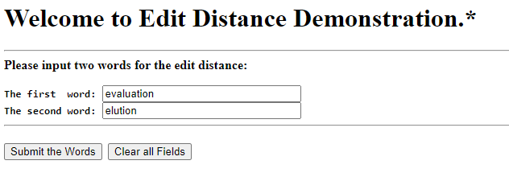
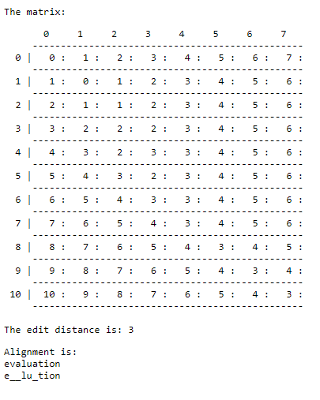

Programming Assignment (due Nov. 18): Write a program to calculate the edit distance between two words and output both the matrix of distance calculation and an alignment that demonstrates the result. Your program should ask for input of two words, calculate the edit distance, output the matrix of calculation and an alignment that verifies the edit distance. You may use any programming language that you are most familiar. In front of your submission you should include a paragraph of comments describing how I can compile and test your program, including the required tools/environment. MATLAB is not acceptable since I do not have MATLAB in my computer.





## Run the program

Requires Python 3. No compilation or third-party packages are needed. From the project root, run:

```sh
cd assignment_nov18
python3 main.py
```

Enter the first word and second word when prompted. The program prints the distance matrix, the edit distance, and an alignment. To check the assignment example, enter `evaluation` and `elution`; the edit distance should be `3`.
